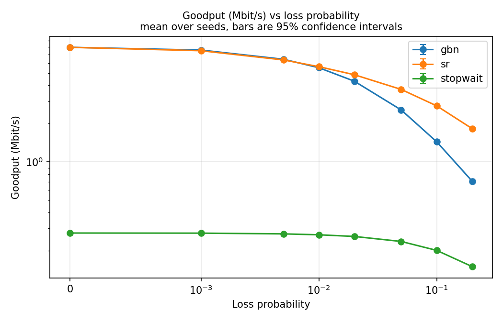
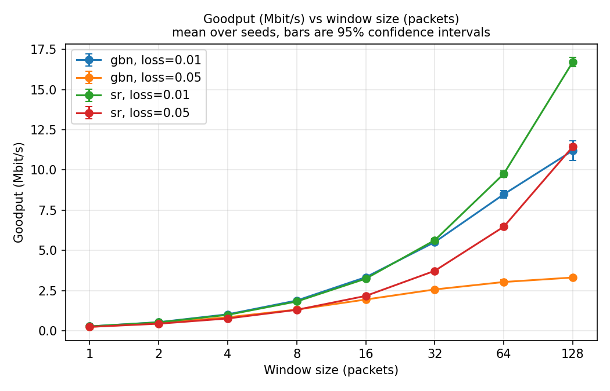
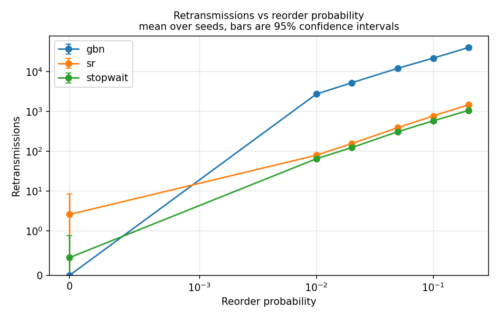
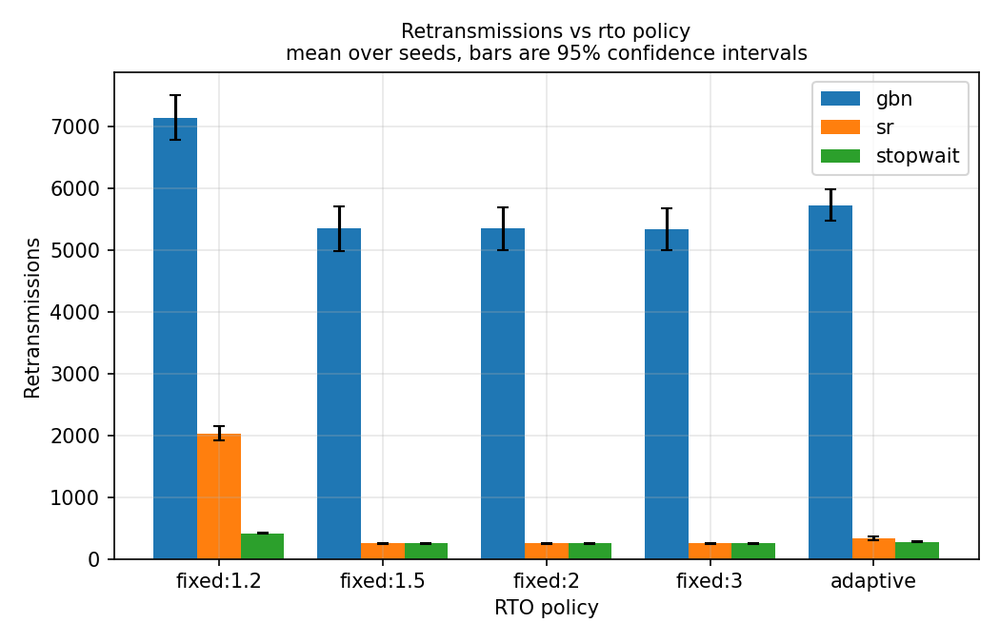
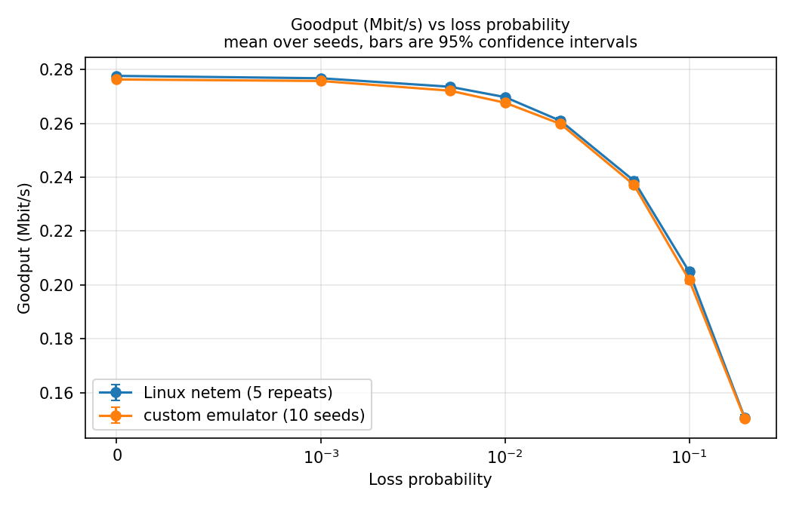

# 4. Results and discussion

The experiments tested two claims. **The primary claim** was that Selective
Repeat (SR) would achieve greater goodput than Go-Back-N (GBN) on a lossy,
jittered path, with the difference growing as loss probability and window size
increased. As a first approximation, GBN's useful delivery probability over a
window of size $W$ was expected to scale like $(1-p)^W$, whereas SR's was
expected to scale more closely with $(1-p)$. Stop-and-Wait was expected to be
limited to roughly one data packet per round trip even without loss. These are
predictions to test, not identities guaranteed by the implementation.

**The secondary claim** was that an adaptive retransmission timeout (RTO) using
Jacobson/Karels estimation and Karn's algorithm would reduce spurious
retransmissions relative to fixed timeouts, without a substantial goodput
penalty. The emulator's JSONL trace provides the evidence needed to separate
spurious retransmissions from retransmissions made necessary by loss.

Unless stated otherwise, the figures use 8 MiB transfers,
1,400-byte data payloads, 20 ms base delay in each direction, uniform
$\pm5$ ms jitter, and 10 seeds per experimental cell. Plotted centres are
arithmetic means of successful runs; error bars show two-sided **95%
confidence intervals** using Student's $t$ distribution. Failed and corrupt
runs were excluded and rerun. All reported results use the corrected-emulator
datasets. All 890 final experiment runs completed with status `ok` and matching sent and received files (`file_match` true), so no run was excluded from the figures.

## 4.1 Experiment 1: goodput versus packet loss

**Question.** How does increasing packet-loss probability affect the goodput
of Stop-and-Wait, GBN, and SR at a fixed window size of 32?

**Prediction from theory.** If the loss probability on each direction is $p$,
a Stop-and-Wait attempt succeeds only when both the DATA packet and its ACK
arrive, so the probability of success is $q=(1-p)^2$. The expected number of
failed attempts before success is $(1-q)/q$. In a simple timeout-cost model,

$$
G_{\mathrm{SW}} \approx
\frac{8\,\mathrm{payload\ bytes}}
     {RTT_{\mathrm{baseline}} + RTO\,(1-q)/q},
\qquad q=(1-p)^2.
$$

The pilot used a measured loss-free baseline, rather than the configured RTT
alone, because processing and packet release also contributed to transfer
time (Section 3.8); the corrected-emulator rerun established the 40.54 ms baseline.
GBN may have to resend a substantial part of its window after one loss,
whereas SR selectively resends the affected packet. Thus SR was expected to
lose less goodput as $p$ rose; the heuristic $(1-p)^W$ for GBN versus $(1-p)$
for SR gives a shape to compare against, not a precise fit to all timeouts
and ACK-loss effects. The loss levels were 0, 0.1, 0.5, 1, 2, 5, 10, and 20%.

*Figure 1. Experiment 1 ($W = 32$, `fixed:1.5`, 8 MiB, delay 20 ms ± 5 ms). Mean goodput of Stop-and-Wait, GBN, and SR against configured packet
loss, with $W=32$ for the windowed protocols. Error bars show 95% confidence
intervals over 10 successful seeds per point.*

**Results and discussion.** Experiment 1 investigated the effect of packet loss on the goodput of Stop-and-Wait (S&W), Go-Back-N (GBN) and Selective Repeat (SR), with a fixed window size of 32 packets (Figure 1). In loss-free conditions, GBN and SR achieved identical goodput of 7.97 Mbit/s, or approximately 29 times the 0.276 Mbit/s achieved by S&W. Below 1% of loss, the two windowed protocols remained within approximately 1% of each other because retransmissions were relatively rare. For higher levels of loss, however, SR began to significantly outperform GBN: 1.45× at 5% loss, 1.92× at 10% loss, and 2.59× at 20% loss. This confirmed the predicted order and widening gap between their performance, as SR could retransmit individual missing packets whereas GBN could retransmit multiple packets after a loss.

| Loss | S&W (Mbit/s) | GBN (Mbit/s) | SR (Mbit/s) | SR / GBN |
|---|---:|---:|---:|---:|
| 0% | 0.276 | 7.97 | 7.97 | 1.00 |
| 0.1% | 0.276 | 7.58 | 7.49 | 0.99 |
| 1% | 0.268 | 5.51 | 5.61 | 1.02 |
| 2% | 0.260 | 4.32 | 4.85 | 1.12 |
| 5% | 0.237 | 2.56 | 3.72 | 1.45 |
| 10% | 0.202 | 1.44 | 2.76 | 1.92 |
| 20% | 0.151 | 0.71 | 1.83 | 2.59 |

The Stop-and-Wait measurements were also compared to an analytical model using the corrected emulator's measured loss-free, per-packet time of 40.54 ms. For a loss probability $p$, the probability that both the DATA packet and its ACK arrive is $q=(1-p)^2$, and the expected goodput can be calculated: $G = 8\times\mathrm{payload}/[T_0+RTO\times(1-q)/q]$, using a 1,400-byte payload, $T_0 = 40.54$ ms and RTO = 60 ms. The model correctly predicted the measured goodput within 0.4% at every tested level of loss except at 10% loss where the deviation was approximately −1.6%. For example, at 20% loss it predicted 150.8 kbit/s against the measured 150.6 kbit/s. This agreement confirmed the correctness of the Stop-and-Wait timing model, and showed that its limited performance was primarily due to allowing just one outstanding packet per round trip.

However, the simplified functional prediction for GBN and SR's goodput could not accurately describe their full behaviour. The table below compares their measured goodput, normalised to the loss-free result, with the theoretical approximations.

| Loss | GBN measured | $(1-p)^{32}$ | SR measured | $(1-p)$ |
|---|---:|---:|---:|---:|
| 1% | 0.69 | 0.73 | 0.71 | 0.99 |
| 2% | 0.54 | 0.52 | 0.61 | 0.98 |
| 5% | 0.32 | 0.19 | 0.47 | 0.95 |
| 20% | 0.09 | 0.001 | 0.23 | 0.80 |

The approximation for GBN, $(1-p)^{32}$, remained reasonably close to the measurements up to about 2% loss but substantially underestimated goodput for higher levels of loss. This was because the approximation effectively treated a loss as wasting an entire window, whereas GBN in fact retains successful delivery of packets before the missing one, and only retransmits from that point. Conversely, SR performed far below the $(1-p)$ approximation because it ignored the effect of timeout stalls. When a packet was lost, SR could retain subsequent packets, but its sending window could not advance past the missing packet until retransmission recovered it. The prediction's ranking and widening gap were confirmed; its functional forms were not.

## 4.2 Experiment 2: goodput versus window size

**Question.** How does window size affect GBN and SR goodput at 1% and 5%
loss?

**Prediction from theory.** With a base RTT of 40 ms, a sender limited to
$W$ outstanding packets can offer at most $W/RTT$ new packets per second in
the no-loss idealisation. Increasing $W$ should initially raise goodput until
roughly $W\times\mathrm{payload}$ reaches the path's effective
bandwidth-delay product, at which point SR should flatten rather than grow
indefinitely. On this experimental loopback path the effective bottleneck and
any plateau must be inferred from the data, not assumed to be a configured
link bandwidth. Under loss, GBN's wasted window retransmissions should be
more pronounced at larger $W$; SR should be better able to retain the gain
from a larger window. The tested window sizes were 1, 2, 4, 8, 16, 32,
64, and 128.

*Figure 2. Experiment 2 (loss 1% and 5%, `fixed:1.5`). Mean GBN and SR goodput versus $W$, separately at 1% and 5% loss.
Error bars show 95% confidence intervals over 10 successful seeds per point.*

**Results and discussion.** Experiment 2 investigated the effect of window size on GBN and SR's performance at 1% and 5% packet loss (Figure 2). With a window size of one both behaved like Stop-and-Wait, achieving approximately 0.27 Mbit/s at 1% loss. That confirmed correctness because neither windowed protocol could have more than one unacknowledged packet outstanding. Increasing the window initially improved goodput for both protocols by allowing multiple packets to remain in flight. The ideal reference goodput was calculated using W × 1,400 bytes × 8 / 41 ms, representing the maximum application-data rate possible with a given window and reference RTT, without loss-affected delays.

| Window | GBN 1% | SR 1% | GBN 5% | SR 5% | Ideal $W/RTT$ |
|---:|---:|---:|---:|---:|---:|
| 1 | 0.27 | 0.27 | 0.24 | 0.24 | 0.27 |
| 8 | 1.88 | 1.82 | 1.31 | 1.30 | 2.19 |
| 32 | 5.51 | 5.63 | 2.56 | 3.72 | 8.74 |
| 64 | 8.48 | 9.75 | 3.03 | 6.47 | 17.48 |
| 128 | 11.20 | 16.71 | 3.31 | 11.44 | 34.97 |

All goodput values are in Mbit/s. The complete eight-window dataset is recorded in `results/exp2_window.csv`.

The gap between them became most significant at 5% loss: increasing the window from 32 to 128 packets only raised GBN goodput from 2.56 to 3.31 Mbit/s, indicating diminishing returns from larger windows. A larger GBN window meant there were more later packets which would be discarded and then retransmitted after a loss, offsetting the benefit of the additional outstanding packets. SR did not suffer the same retransmission amplification because it buffered out-of-order packets and selectively recovered missing ones: its goodput increased from 3.72 to 11.44 Mbit/s over the same window range, or about 3.5 times GBN at $W = 128$. At 1% loss, both continued improving, but SR's advantage began to become more pronounced at $W = 64$ and $W = 128$.

No conventional bandwidth-delay-product plateau was observed because the loopback path had no deliberate bandwidth limit. The window-to-RTT ratio instead provided an ideal reference, with retransmissions and recovery delays keeping actual goodput below that. At $W = 128$ and 1% loss, SR achieved 16.71 Mbit/s, or approximately 48% of the ideal 34.97 Mbit/s. This was equivalent to approximately 1,500 DATA packets/s or 3,000 packets/s including ACKs, substantially below the emulator's calibrated operating budget. The reduced scaling and eventual flattening in GBN were therefore attributable primarily to protocol behaviour under loss, and not the experimental infrastructure.

## 4.3 Experiment 3: sensitivity to deliberate reordering

**Question.** How does increasing the deliberate packet-reordering
probability affect retransmissions in Stop-and-Wait, GBN, and SR?

**Prediction from theory.** Jitter by itself kept packets in order along each
emulated path, so any induced reordering in this experiment came from the
explicit `reorder` parameter. Deliberately delayed Stop-and-Wait packets
could prompt a spurious resend when the resulting RTT exceeded the RTO. GBN
receivers discard packets arriving after the delayed packet because they are
out of order. The sender may receive duplicate cumulative ACKs but only counts
them; it does not fast-retransmit. When its retransmission timer expires, the
sender resends the outstanding window, even if some copies had already arrived.
SR can buffer out-of-order packets and retransmit only entries that remain unacknowledged, so its retransmission
count should rise less sharply. The tested reorder probabilities were
0, 1, 2, 5, 10, and 20%.

*Figure 3. Experiment 3 (no loss, $W = 32$, `fixed:1.5`); symmetric-log axis. Mean retransmission count for Stop-and-Wait, GBN, and SR versus
configured reordering probability, with $W=32$ for GBN and SR. Error bars
show 95% confidence intervals over 10 successful seeds per point.*

**Results and discussion.** Experiment 3 investigated the three protocols' sensitivity to reordering, without introducing packet loss (Figure 3). The results demonstrated that reordering alone could massively reduce goodput, particularly for GBN: increasing reorder probability from 0% to 20% reduced GBN goodput from 7.97 to 0.88 Mbit/s, or around 89%. Over the same range, SR goodput decreased from 7.96 to 5.39 Mbit/s (around 32%), and S&W from 0.274 to 0.230 Mbit/s. The retransmission counts revealed an even larger difference: at 20% reordering, GBN recorded 39,831 retransmissions against 1,456 for SR.

| Reorder | Retx S&W | Retx GBN | Retx SR | S&W (Mbit/s) | GBN (Mbit/s) | SR (Mbit/s) |
|---|---:|---:|---:|---:|---:|---:|
| 0% | 0 | 0 | 3 | 0.274 | 7.97 | 7.96 |
| 1% | 65 | 2,714 | 79 | 0.272 | 5.61 | 7.37 |
| 5% | 310 | 12,088 | 392 | 0.263 | 2.63 | 6.46 |
| 20% | 1,056 | 39,831 | 1,456 | 0.230 | 0.88 | 5.39 |

GBN suffered because it discarded packets which appeared out of order, even when the previous packet was merely delayed. Once GBN's retransmission timer expired, it would retransmit outstanding packets from oldest unacknowledged, generating substantial unnecessary retransmission traffic. SR simply buffered out-of-order packets, allowing them to be retained until the missing packet arrived. Its retransmission count remained far lower. Stop-and-Wait also experienced retransmissions despite having only one outstanding DATA packet, so conventional reorder between outstanding DATA packets was impossible. These retransmissions occurred because the additional 20 ms reorder delay could extend the RTT to 70 ms, exceeding the configured 60 ms RTO and triggering premature retransmission.

The loss-free, zero-reordering configuration also served as evidence that the emulator's scheduling correction was effective. GBN recorded zero retransmissions under these conditions, whereas the earlier emulator implementation had produced approximately 112,000 retransmissions because independent per-packet jitter reordered back-to-back packets. Removing that artificial reordering permitted the experiment to observe the intended effects of reordering. Overall, the results showed that SR's ability to accept and buffer out-of-order packets provided a major advantage even if the network delivered every original packet.

## 4.4 Experiment 4: fixed versus adaptive RTO

**Question.** How do fixed and adaptive RTO policies trade off spurious
retransmissions, necessary recovery, and goodput at 2% loss?

**Prediction from theory.** With 20 ms base delay in each direction, the base
RTT is 40 ms; with $\pm5$ ms jitter in each direction, an unimpeded RTT can
reach 50 ms. Thus `fixed:1.2` is just 48 ms, shorter than some legitimate
round trips, and was expected to trigger spurious timeouts. Conversely,
`fixed:3` is 120 ms and should avoid many such timeouts but wait longer to
recover genuine loss. Intermediate fixed choices (`fixed:1.5`, `fixed:2`)
trade those costs against one another. The adaptive RTO should track RTT
variation and avoid many premature timeouts without consistently paying the
long delay of an oversized fixed RTO; this advantage must be checked, not
assumed. The corrected emulator timing matters here because the original
release loop added around 2 ms per round trip, enough to influence the
48 ms policy.

*Figure 4. Experiment 4 (2% loss, $W = 32$). Mean total retransmissions by RTO policy for Stop-and-Wait, GBN,
and SR at 2% loss. Error bars show 95% confidence intervals over 10 successful
seeds per point.*

**Results and discussion.** Experiment 4 compared fixed and adaptive retransmission timeout policies under 2% packet loss (Figure 4). Retransmissions were classified using emulator traces into necessary retransmissions, early-timer retransmissions, lost-ACK retransmissions and retransmissions occurring after the relevant ACK had arrived. The `spurious.py` script replayed each emulator trace and, for every retransmission, identified which packet copy the receiver actually accepted. It then checked whether a covering ACK had been sent and was still in flight, had been sent and subsequently dropped, or had never been sent; the `ACK lost` category was assigned only when a covering ACK had been sent and dropped. Necessary retransmissions represented packets which required recovery, and lost-ACK retransmissions occurred because the sender had not received the acknowledgement confirming successful delivery. Early-timer retransmissions occurred when the original transmission had succeeded, but the timeout expired before its ACK arrived. The additional after-ACK cases were associated with near-simultaneous timer and ACK processing, often separated by fractions of a millisecond, and were included when measuring RTO-related overhead. The table reports early-timer counts with these after-ACK cases included in parentheses.

| Protocol | Policy | Goodput | Early timer (+ after ACK) | ACK lost | Necessary |
|---|---|---:|---:|---:|---:|
| S&W | fixed:1.2 | 262 kbit/s | 130 (+34) | 129 | 123 |
| S&W | fixed:1.5 / 2 / 3 | 260 / 255 / 246 kbit/s | 0 | 128 | 123 |
| S&W | adaptive | 261 kbit/s | 20 (+3) | 128 | 123 |
| GBN | fixed:1.2 | 5.17 Mbit/s | 3,035 (+358) | 2 | 3,742 |
| GBN | fixed:1.5 | 4.32 Mbit/s | 60 | 2 | 5,282 |
| GBN | fixed:2 | 3.55 Mbit/s | 29 | 0 | 5,316 |
| GBN | fixed:3 | 2.62 Mbit/s | 16 | 0 | 5,314 |
| GBN | adaptive | 4.63 Mbit/s | 690 (+55) | 2 | 4,974 |
| SR | fixed:1.2 | 5.21 Mbit/s | 1,440 (+336) | 132 | 123 |
| SR | fixed:1.5 | 4.86 Mbit/s | 0 | 128 | 123 |
| SR | fixed:2 | 4.17 Mbit/s | 0 | 128 | 123 |
| SR | fixed:3 | 3.24 Mbit/s | 0 | 128 | 123 |
| SR | adaptive | 4.59 Mbit/s | 57 (+27) | 127 | 123 |

The results partially confirmed the prediction that adaptive RTO would reduce unnecessary retransmissions. Compared with the aggressive `fixed:1.2` policy, adaptive RTO substantially reduced early-timer events: from 130 to 20 for S&W, 3,035 to 690 for GBN, and 1,440 to 57 for SR, excluding the separately reported after-ACK cases. However, adaptive RTO did not always outperform every fixed policy on this measure. The more conservative `fixed:1.5` and `fixed:3` policies produced few or no early-timer retransmissions, but at the cost of longer recovery delays which reduced goodput. Lost-ACK retransmissions were relatively stable across policies for S&W and SR (about 128 per run) because changing the timeout could not recover a missing acknowledgement without retransmission. GBN's much larger necessary-retransmission counts were due to its receiver discarding out-of-order packets, forcing later packets to be retransmitted even if their original copies had reached the receiver.

The shortest timeout still delivered the highest goodput for all three protocols, for example 5.21 Mbit/s with SR's `fixed:1.2` compared with 4.86 Mbit/s at `fixed:1.5` and 3.24 Mbit/s at `fixed:3`. At `fixed:1.2`, the RTO was 48 ms, below the maximum unimpeded RTT of 50 ms, so legitimate exchanges could trigger premature timeouts that adaptive RTO could reduce. By contrast, the fixed policies from `fixed:1.5` to `fixed:3` used 60–120 ms timeouts, already above the maximum unimpeded RTT, leaving few early retransmissions for adaptive RTO to eliminate; their main cost was slower recovery from genuine losses. The longer timeout prevented premature retransmissions but delayed recovery from genuine losses, with about 33% lower goodput at `fixed:3` than at `fixed:1.5`. Adaptive RTO provided an intermediate trade-off with neither the highest goodput nor the fewest unnecessary retransmissions. The correction to the emulator had also materially changed these results: S&W at `fixed:1.2` produced 416 retransmissions with the corrected emulator, compared with 645 previously, and so approximately 230 of the earlier retransmissions were associated with emulator scheduling lateness. These results illustrate that preferred RTO policy depends on whether the goal is maximum useful-data rate or reduced retransmission overhead.

## 4.5 Validation against Linux netem

The custom emulator was independently compared with Linux `netem` using
Stop-and-Wait at matching delay, jitter, and loss settings. Section 3.10
explains why this is a statistical comparison rather than a packet-by-packet
replay and records the preliminary timing diagnosis. The final comparison uses the corrected-emulator results.

*Figure 5. Validation (Stop-and-Wait, delay 20 ms ± 5 ms, same loss levels as experiment 1). Mean Stop-and-Wait goodput versus packet loss, comparing the custom
emulator with Linux `netem`. Error bars show 95% confidence intervals; the
Linux `netem` data use five seeded repeats per loss level; the custom
emulator uses ten seeds per loss level.*

**Results and discussion.** As shown in Figure 5, the custom channel emulator was independently tested against Linux `netem` by comparing Stop-and-Wait goodput across eight packet-loss levels, with a 20 ms delay and ±5 ms jitter in each direction. The custom emulator used ten seeds per level, and netem used five seeded repetitions. Each dataset was summarised with its mean and 95% Student's t confidence interval (critical values: 2.262 and 2.776 respectively). For each loss level, the relative gap was calculated as (emulator mean − netem mean) / netem mean using the Stop-and-Wait goodput values. This tested whether two separately implemented sources of impairment yielded similar performance trends under equivalent nominal network conditions. The mean goodput values differed by no more than 1.5% across the full loss range. The netem dataset was regenerated on the same build used for the other results after a review identified stale counters in the earlier validation run.

| Loss | Custom emulator (kbit/s) | Linux netem (kbit/s) | Relative gap | 95% CIs overlap |
|---|---:|---:|---:|---|
| 0% | 276.3 ± 0.6 | 277.6 ± 0.5 | −0.5% | No |
| 0.1% | 275.7 ± 0.3 | 276.7 ± 0.5 | −0.4% | No |
| 0.5% | 272.1 ± 0.3 | 273.6 ± 0.8 | −0.5% | No |
| 1% | 267.6 ± 0.5 | 269.7 ± 0.6 | −0.8% | No |
| 2% | 259.7 ± 0.6 | 260.9 ± 1.2 | −0.4% | Yes |
| 5% | 237.2 ± 1.0 | 238.7 ± 1.4 | −0.6% | Yes |
| 10% | 201.8 ± 1.3 | 204.9 ± 1.3 | −1.5% | No |
| 20% | 150.6 ± 0.9 | 150.8 ± 1.1 | −0.1% | Yes |

The 95% confidence intervals overlapped at three of the eight loss levels, although the mean goodput values were within 0.1–1.5% of one another throughout. The custom emulator was systematically slower, typically by about 0.5%, consistent with the approximately 0.4 ms additional round-trip overhead of its separate process hop identified in Section 3.10. The narrow confidence intervals made this small absolute difference visible at several loss levels. However, the response to increasing packet loss followed nearly the same shape in both setups, and the curves in Figure 5 lie close together. This agreement in the loss-response pattern supports the custom emulator's loss model, even though the two implementations were not statistically identical in absolute goodput. Its slightly lower absolute values are conservative, while comparisons among S&W, GBN and SR remain on a common basis because each protocol was tested through the same emulator.
